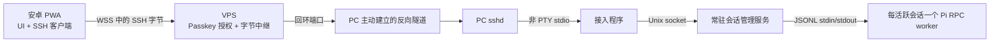

# ADR：远程 Pi 的连接与会话边界

状态：提议，待审阅

## 决策背景

目标是让安卓 PWA 经公网入口访问多台 PC 上的 Pi，同时把项目文件、Pi 配置、扩展和模型凭据保留在各 PC。手机连接会因锁屏和网络变化而中断，Pi 会话需要独立于手机持续运行。

## 拟采用的结构

PC → VPS 的 SSH 连接只建立反向端口转发；手机 → PC 的 SSH 连接在这条路径内完成端到端认证与加密。VPS 对 WSS 握手校验登录态、Origin 和主机授权，并将主机 ID 解析为固定回环端口。VPS 的 SSH 隧道账号仅允许对应端口转发，转发监听保持在回环地址。PC 的 sshd 仅允许专用手机公钥执行受限接入程序；接入程序把 stdio 接到本机管理服务，不承担 worker 生命周期。

| 凭据 | 持有处 | 验证处 | 用途 |
|---|---|---|---|
| Passkey | 手机认证器 | VPS 网站 | 登录并取得中继访问权 |
| 手机 SSH 私钥 | PWA 加密本地存储 | PC sshd | 认证手机到 PC 的连接 |
| PC 隧道 SSH 私钥 | 对应 PC | VPS sshd | 建立该 PC 的反向转发 |

PWA 在首次可信登记后保存 PC 主机公钥或指纹，后续连接严格比对。PWA 的前端代码来自 VPS 网站，因此前端发布与更新也属于此方案的信任边界。

## 会话与协议

每个活跃会话拥有一个 Pi RPC worker；PC 常驻服务负责创建、加载、订阅、停止和崩溃后重新加载会话。worker 以项目目录为工作目录，以运行 Pi 的用户身份启动，并显式配置服务环境。管理服务持续读取 Pi stdout，将响应与事件分发给订阅者。会话历史使用 Pi 的 session 文件，应用侧保存会话索引、控制权、操作接收结果和重连所需的事件游标。

应用协议先选择 `sessionId`，再携带 Pi RPC 命令。`rpc.id` 关联单次命令响应，`clientActionId` 识别客户端重试；管理服务在接收操作时记录接收结果，重连时由客户端查询该结果后决定是否补发。流式事件附会话 ID 与递增序号。订阅先建立，再取一致的历史与当前状态并接续事件；事件缺口时重新同步。Pi 的 `prompt` 响应表示命令被处理，界面按后续事件及 `agent_settled` 判断运行结束。

多端可同时订阅，同一会话首版只授予一个客户端写入控制权。控制权的取得、释放及失联后的收回由管理服务管理，防止两个客户端同时提交。标准扩展 UI 请求由管理服务转交当前控制端并把响应送回 Pi；通知、状态和 widget 按事件分发。

## 选择理由与适用边界

- Pi RPC 的进程隔离和 JSONL 流便于按会话管理 worker，并让 Pi 继续使用 PC 的资源与凭据。
- 浏览器 SSH 让 VPS 保持为入口与密文字节中继，同时由 PC sshd 管理手机身份。PWA 仍须负责主机密钥核验和私钥保护。
- 常驻服务把任务生命周期从手机连接中分离，使锁屏后继续执行和多端同步有明确的状态所有者。
- 当 PC 或 worker 重启时，Pi session 文件可恢复对话；进行中的工具执行以中断状态展示。

## 决策关口

浏览器 SSH 路线须先在目标安卓浏览器证明：JS／WASM 客户端能通过 WSS 与标准 sshd 通信；强制校验主机密钥；以本地私钥认证；打开**非 PTY exec channel**；在 channel 中可靠地双向传输应用协议。候选库先比较接口和必要的最小改造量。若无法满足，需重新审议连接层 ADR，之后才继续后续阶段。
